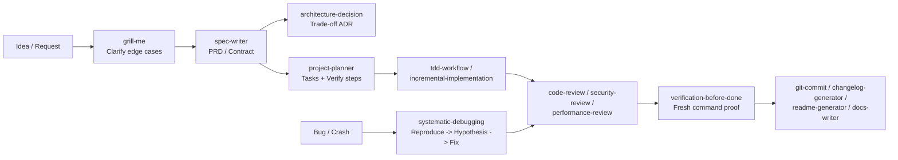

# DevKit OpenCode (`devkit-opencode`)

[Tiếng Việt](README.md) | **English**

A practical, engineering-disciplined suite of **24 OpenCode Skills** and **8 Custom Slash Commands** built on the [Agent Skills specification](https://opencode.ai/docs/skills/) for developers from **students to mid-level engineers**.

Instead of loose one-off prompt snippets, `devkit-opencode` covers the **entire software development lifecycle**: requirements clarification, specs & ADRs, task planning, TDD & incremental slices, evidence-based debugging, pre-completion verification, multi-dimensional reviews, web/backend engineering, and structured student learning.

---

## Core Philosophy

1. **Clarify Before Coding:** Interrogate vague requests (`grill-me`), lock contracts (`spec-writer`), and break down tasks with verification steps (`project-planner`).
2. **Disciplined Implementation:** Red-Green-Refactor (`tdd-workflow`) and small verified vertical slices (`incremental-implementation`).
3. **Never Guess When Debugging:** Reproduce → Gather logs/traces → Formulate 1 hypothesis → Verify → Fix root cause (`systematic-debugging`).
4. **No Completion Claims Without Proof:** Run fresh tests, typechecks, and builds after the final edit (`verification-before-done`).
5. **One Skill = One Clear Job:** Each `SKILL.md` provides sharp trigger boundaries, a step-by-step workflow, explicit **Anti-Patterns**, and concrete Input/Output examples.

---

## Skill Lifecycle Flow



---

## Complete Skill Catalog (24 Skills)

### A. Planning & Requirements
| # | Skill | Purpose | Typical Trigger |
|---|---|---|---|
| 1 | [grill-me](skills/grill-me/SKILL.md) | Relentlessly clarify requirements, edge cases, and non-goals before coding | Vague feature request or unclear constraints |
| 2 | [spec-writer](skills/spec-writer/SKILL.md) | Write crisp PRDs with flows, contracts, edge cases, and acceptance criteria | Need a formal spec after requirements alignment |
| 3 | [project-planner](skills/project-planner/SKILL.md) | Break specs into dependency-ordered tasks with per-task verification commands | Need an executable implementation roadmap |
| 4 | [architecture-decision](skills/architecture-decision/SKILL.md) | Author objective ADRs comparing options, ops costs, and reversibility | Choosing stacks, DBs, queues, or system boundaries |

### B. Implementation Discipline
| # | Skill | Purpose | Typical Trigger |
|---|---|---|---|
| 5 | [tdd-workflow](skills/tdd-workflow/SKILL.md) | Strict Red-Green-Refactor: failing test first, minimal pass, safe refactor | Implementing business logic, APIs, or regression fixes |
| 6 | [incremental-implementation](skills/incremental-implementation/SKILL.md) | Deliver multi-file work in small green vertical slices | Executing multi-layer plans without big-bang diffs |
| 7 | [systematic-debugging](skills/systematic-debugging/SKILL.md) | 6-step scientific root-cause debugging (with 2-hypothesis circuit breaker) | Investigating crashes, regressions, or flaky tests |
| 8 | [verification-before-done](skills/verification-before-done/SKILL.md) | Final gate requiring fresh post-edit test/build evidence before claiming done | Before concluding any fix, feature, or PR |

### C. Code Quality & Review
| # | Skill | Purpose | Typical Trigger |
|---|---|---|---|
| 9 | [code-review](skills/code-review/SKILL.md) | Multi-dimensional review ranked from `[Blocker]` to `[Nit]` with exact fixes | Reviewing diffs, PRs, or modules |
| 10 | [security-review](skills/security-review/SKILL.md) | Audit OWASP Top 10, AuthN/AuthZ (IDOR), injection, secrets, and dependencies | Auditing auth, uploads, webhooks, or security posture |
| 11 | [performance-review](skills/performance-review/SKILL.md) | Measure-first optimization for N+1 queries, memory, complexity, and bundles | Investigating slow endpoints, CPU spikes, or lag |
| 12 | [refactor-safe](skills/refactor-safe/SKILL.md) | Behavior-preserving restructuring guarded by characterization tests | Splitting monoliths or renaming module contracts |
| 13 | [code-simplification](skills/code-simplification/SKILL.md) | Flatten deep nesting, remove dead abstractions and over-engineering | Simplifying bloated, hard-to-read local logic |

### D. Daily Dev Tools
| # | Skill | Purpose | Typical Trigger |
|---|---|---|---|
| 14 | [git-commit](skills/git-commit/SKILL.md) | Craft Conventional Commits grounded strictly in `git diff`, checking for secrets | Staging/committing changes or splitting mixed diffs |
| 15 | [changelog-generator](skills/changelog-generator/SKILL.md) | Build Keep-a-Changelog release notes from real `git log` / tags | Preparing releases or updating `CHANGELOG.md` |
| 16 | [readme-generator](skills/readme-generator/SKILL.md) | Generate/update `README.md` verified against real scripts and env files | Bootstrapping or refreshing project READMEs |
| 17 | [docs-writer](skills/docs-writer/SKILL.md) | Write high-signal docstrings, API guides, architecture notes, and runbooks | Documenting code contracts or ops procedures |

### E. Web & Backend
| # | Skill | Purpose | Typical Trigger |
|---|---|---|---|
| 18 | [api-designer](skills/api-designer/SKILL.md) | Design REST/GraphQL APIs (status codes, pagination, idempotency, errors) | Designing endpoints or OpenAPI/GraphQL contracts |
| 19 | [database-schema](skills/database-schema/SKILL.md) | Model normalized schemas, DB constraints, composite indexes, safe migrations | Designing SQL/Prisma schemas or zero-downtime migrations |
| 20 | [frontend-component](skills/frontend-component/SKILL.md) | Build accessible, responsive UI components matching project design tokens | Creating React/Vue/Svelte/Tailwind components |
| 21 | [docker-setup](skills/docker-setup/SKILL.md) | Write multi-stage Dockerfiles (non-root, cached) and healthchecked Compose | Containerizing apps or local/prod stacks |

### F. Student & Learning
| # | Skill | Purpose | Typical Trigger |
|---|---|---|---|
| 22 | [dsa-explainer](skills/dsa-explainer/SKILL.md) | Teach DSA with intuition, dry-run trace, Big-O proof, and reference code | Learning algorithms or data structures |
| 23 | [leetcode-helper](skills/leetcode-helper/SKILL.md) | Coach coding interview problems via progressive hints without instant spoilers | Solving LeetCode or debugging `WA`/`TLE` |
| 24 | [assignment-helper](skills/assignment-helper/SKILL.md) | Mentor coursework & capstone projects ethically (rubric, design, report, viva) | Term projects, labs, or graduation capstones |

---

## Custom Slash Commands (`commands/`)

| Command | Agent | Backing Skill | Purpose |
|---|---|---|---|
| `/grill <idea>` | `plan` | [grill-me](skills/grill-me/SKILL.md) | Clarify scope & edge cases before coding (read-only) |
| `/plan <feature>` | `plan` | [project-planner](skills/project-planner/SKILL.md) | Break feature into verified implementation tasks |
| `/tdd <task>` | `build` | [tdd-workflow](skills/tdd-workflow/SKILL.md) | Implement strictly via Red-Green-Refactor |
| `/debug <issue>` | `build` | [systematic-debugging](skills/systematic-debugging/SKILL.md) | Run 6-step evidence-based root-cause debugging |
| `/verify` | `build` | [verification-before-done](skills/verification-before-done/SKILL.md) | Run post-edit test/build verification checks |
| `/review <scope>` | `plan` | [code-review](skills/code-review/SKILL.md) | Perform severity-ranked code review |
| `/security <scope>` | `plan` | [security-review](skills/security-review/SKILL.md) | Audit auth, authorization, injection, and secrets |
| `/commit` | `build` | [git-commit](skills/git-commit/SKILL.md) | Craft an accurate Conventional Commit from git diff |

---

## Quick Installation

Full installation options (including Project-local and manual symlink setups) are in [INSTALL.md](INSTALL.md).

### Scripted Install (Recommended — Auto-Backups Existing Configs)

- **Windows (PowerShell):**

```powershell
git clone https://github.com/vuloc080611/DevKit-OpenCode.git
Set-Location DevKit-OpenCode
powershell -ExecutionPolicy Bypass -File .\scripts\install.ps1
```

- **Linux / macOS:**

```bash
git clone https://github.com/vuloc080611/DevKit-OpenCode.git
cd DevKit-OpenCode
chmod +x scripts/install.sh && ./scripts/install.sh
```

*(Pass `-CoreOnly` / `--core-only` to install just the 9 core discipline skills, or `-Scope Project` / `--project` for project-local `.opencode/` setup.)*

### Quick Install via `skills` CLI

```bash
npx skills add vuloc080611/DevKit-OpenCode -a opencode -g
```

---

## Recommended Adoption Order

1. **Clarify & Plan:** `grill-me` + `project-planner`
2. **Debug & Verify:** `systematic-debugging` + `verification-before-done`
3. **Test-First Coding:** `tdd-workflow`
4. **Quality & Security:** `code-review` + `security-review`
5. **Daily Git & Docs:** `git-commit` + `readme-generator`
6. **Domain & Learning:** Web/Backend (`api-designer`, `database-schema`, `frontend-component`, `docker-setup`), Refactoring/Perf, or Learning (`dsa-explainer`, `leetcode-helper`, `assignment-helper`).

---

## Validation & Contributing

- Validate repository integrity locally with:
  ```bash
  python scripts/validate.py
  ```
- Review trigger accuracy prompts in [docs/eval-prompts.md](docs/eval-prompts.md).
- Read [CONTRIBUTING.md](CONTRIBUTING.md) before proposing new skills or commands, and see [CHANGELOG.md](CHANGELOG.md) for release history.

## License

Released under the [MIT License](LICENSE).
