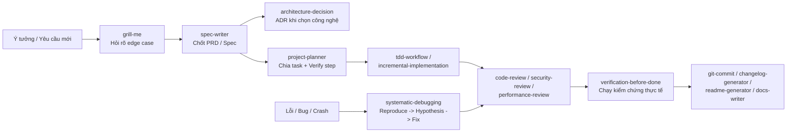

# DevKit OpenCode (`devkit-opencode`)

**Tiếng Việt** | [English](README.en.md)

Bộ **24 OpenCode Skills** và **8 Custom Slash Commands** chuẩn [Agent Skills](https://opencode.ai/docs/skills/), thực tế và có kỷ luật dành cho lập trình viên từ **sinh viên đến mid-level**.

Thay vì chỉ gồm các công cụ đơn lẻ rời rạc, `devkit-opencode` bao quát **toàn bộ vòng đời phát triển phần mềm**: từ làm rõ yêu cầu, viết spec, lập kế hoạch, thực thi theo TDD/slice nhỏ, debug có hệ thống, verify trước khi báo xong, review đa chiều, cho tới hỗ trợ học tập và làm đồ án.

---

## Triết Lý Cốt Lõi

1. **Rõ ràng trước khi code**: Yêu cầu mơ hồ thì hỏi đến cùng (`grill-me`), chốt hợp đồng bằng spec (`spec-writer`), chia task có bước kiểm chứng (`project-planner`).
2. **Kỷ luật khi triển khai**: Test fail trước khi viết code (`tdd-workflow`), làm từng slice nhỏ giữ build luôn xanh (`incremental-implementation`).
3. **Không đoán mò khi sửa lỗi**: Tái hiện → Thu thập log → Đặt 1 giả thuyết → Kiểm chứng → Sửa tận gốc (`systematic-debugging`).
4. **Không báo "xong" khi thiếu bằng chứng**: Luôn chạy test, typecheck, build sau lần sửa cuối cùng trước khi kết luận (`verification-before-done`).
5. **Một skill = Một việc rõ ràng**: Mỗi skill có `description` với trigger cụ thể, quy trình từng bước, danh sách anti-pattern (*Không được làm*) và ví dụ Input/Output thực tế.

---

## Luồng Phối Hợp Giữa Các Skill



---

## Danh Sách 24 Skills Đầy Đủ

### A. Planning & Requirements (Trước khi code)

| # | Skill | Nhiệm vụ chính | Khi nào kích hoạt |
|---|---|---|---|
| 1 | [grill-me](skills/grill-me/SKILL.md) | Hỏi liên tục làm rõ yêu cầu, ràng buộc, edge case, success criteria trước khi code | Yêu cầu mơ hồ, feature lớn, hoặc user muốn làm rõ kỹ trước khi viết code |
| 2 | [spec-writer](skills/spec-writer/SKILL.md) | Chuyển yêu cầu đã thống nhất thành PRD / Feature Spec ngắn gọn, có Non-Goals và Acceptance Criteria | Cần đặc tả tính năng, user flow, data contract trước khi chia task |
| 3 | [project-planner](skills/project-planner/SKILL.md) | Chia feature thành các task nhỏ theo thứ tự phụ thuộc kèm bước kiểm chứng cụ thể cho từng task | Cần lập implementation plan chi tiết trước khi code |
| 4 | [architecture-decision](skills/architecture-decision/SKILL.md) | Viết ADR so sánh khách quan các phương án, trade-offs, chi phí vận hành và khả năng đảo ngược | Chọn database, queue, auth flow, kiến trúc hệ thống hoặc thư viện lớn |

### B. Implementation Discipline (Kỷ luật viết code & sửa lỗi)

| # | Skill | Nhiệm vụ chính | Khi nào kích hoạt |
|---|---|---|---|
| 5 | [tdd-workflow](skills/tdd-workflow/SKILL.md) | Bắt buộc chu trình Red-Green-Refactor: viết test fail trước → code tối thiểu để pass → refactor | Implement logic nghiệp vụ, parser, API handler hoặc fix bug kèm regression test |
| 6 | [incremental-implementation](skills/incremental-implementation/SKILL.md) | Thực thi từng vertical slice nhỏ, kiểm tra xanh sau mỗi bước trước khi đi tiếp | Triển khai feature nhiều lớp (DB → API → UI) hoặc refactor nhiều file |
| 7 | [systematic-debugging](skills/systematic-debugging/SKILL.md) | Debug khoa học: Reproduce → Đọc log/trace → 1 Hypothesis → Verify giả thuyết → Sửa tận gốc | Gặp bug, crash, flaky test, regression hoặc behavior bất thường |
| 8 | [verification-before-done](skills/verification-before-done/SKILL.md) | Cổng kiểm tra cuối: bắt buộc chạy lại test/build/typecheck sau edit cuối cùng mới được báo xong | Trước khi kết luận hoàn thành, mở PR hoặc bàn giao code |

### C. Code Quality & Review (Chất lượng, Bảo mật & Tối ưu)

| # | Skill | Nhiệm vụ chính | Khi nào kích hoạt |
|---|---|---|---|
| 9 | [code-review](skills/code-review/SKILL.md) | Review đa chiều (Correctness, Edge Cases, Security, Performance, Readability, Tests) xếp hạng Blocker → Nit | Review diff, PR hoặc kiểm tra chất lượng module trước khi merge |
| 10 | [security-review](skills/security-review/SKILL.md) | Kiểm tra OWASP Top 10, AuthN/AuthZ (IDOR/BOLA), SQLi, XSS, Command Injection, SSRF, secrets & dependency | Audit route nhạy cảm, thanh toán, upload file, webhook hoặc config bảo mật |
| 11 | [performance-review](skills/performance-review/SKILL.md) | Đo lường trước rồi mới tối ưu: query N+1, index, memory leak, độ phức tạp thuật toán, bundle size | Endpoint chậm, CPU/RAM tăng cao, truy vấn nặng hoặc UI lag |
| 12 | [refactor-safe](skills/refactor-safe/SKILL.md) | Tái cấu trúc code giữ nguyên 100% behavior dựa trên characterization test và từng bước nhỏ | Tách hàm/module lớn, dọn legacy code mà không được làm hỏng logic cũ |
| 13 | [code-simplification](skills/code-simplification/SKILL.md) | Giảm độ phức tạp, lồng `if` sâu, abstraction thừa và over-engineering nhưng giữ nguyên an toàn | Code rối, nhiều boilerplate, nhiều tầng wrapper không cần thiết |

### D. Daily Dev Tools (Công cụ hằng ngày)

| # | Skill | Nhiệm vụ chính | Khi nào kích hoạt |
|---|---|---|---|
| 14 | [git-commit](skills/git-commit/SKILL.md) | Đọc `git diff --staged`, kiểm tra lộ secrets/tính nguyên tử và tạo Conventional Commit chuẩn | Chuẩn bị commit code hoặc tách commit từ working tree lộn xộn |
| 15 | [changelog-generator](skills/changelog-generator/SKILL.md) | Tổng hợp release notes (Keep a Changelog) từ lịch sử `git log` / tag thực tế, lọc nhiễu và nhấn mạnh Breaking Changes | Ra bản release mới hoặc cập nhật `CHANGELOG.md` |
| 16 | [readme-generator](skills/readme-generator/SKILL.md) | Quét codebase, scripts, env vars thực tế để viết/cập nhật `README.md` chính xác, không bịa lệnh | Tạo mới hoặc làm mới `README.md` cho repo |
| 17 | [docs-writer](skills/docs-writer/SKILL.md) | Viết TSDoc/docstring giàu thông tin (contract, invariants, errors), hướng dẫn API và ops runbook | Viết tài liệu kỹ thuật, docstring chuẩn hoặc tài liệu vận hành |

### E. Web & Backend (Thiết kế hệ thống Web/App)

| # | Skill | Nhiệm vụ chính | Khi nào kích hoạt |
|---|---|---|---|
| 18 | [api-designer](skills/api-designer/SKILL.md) | Thiết kế REST/GraphQL API nhất quán: resource, status code, pagination, idempotency, error envelope | Thiết kế endpoint mới, OpenAPI spec hoặc chuẩn hóa API contract |
| 19 | [database-schema](skills/database-schema/SKILL.md) | Thiết kế bảng, quan hệ, DB constraints, composite index theo query thực tế và migration an toàn (Expand-Contract) | Tạo schema SQL/Prisma/Drizzle, tối ưu index hoặc viết migration |
| 20 | [frontend-component](skills/frontend-component/SKILL.md) | Xây dựng UI component sạch, accessible (keyboard, ARIA, focus), đủ loading/empty/error, không mang "AI slop" | Tạo hoặc cải tiến component React/Vue/Svelte/Tailwind |
| 21 | [docker-setup](skills/docker-setup/SKILL.md) | Tạo multi-stage `Dockerfile` tối ưu cache, chạy non-root, `.dockerignore` và `compose.yaml` có healthcheck | Containerize ứng dụng hoặc dựng môi trường Docker local/production |

### F. Student & Learning (Sinh viên & Tự học)

| # | Skill | Nhiệm vụ chính | Khi nào kích hoạt |
|---|---|---|---|
| 22 | [dsa-explainer](skills/dsa-explainer/SKILL.md) | Giải thích cấu trúc dữ liệu & thuật toán từ bản chất: trực giác → chạy tay từng bước → chứng minh Big-O → code mẫu | Học thuật toán (BFS/DFS, Dijkstra, DP, Monotonic Stack, Segment Tree...) |
| 23 | [leetcode-helper](skills/leetcode-helper/SKILL.md) | Huấn luyện giải bài thuật toán theo gợi ý từng nấc (không spoil ngay code đáp án trừ khi được yêu cầu) | Luyện LeetCode/interview, debug lỗi `WA`/`TLE` |
| 24 | [assignment-helper](skills/assignment-helper/SKILL.md) | Hỗ trợ đồ án / bài tập lớn có trách nhiệm: phân tích rubric, kiến trúc, dàn ý báo cáo, chuẩn bị hỏi đáp bảo vệ | Làm đồ án môn học, đồ án tốt nghiệp hoặc viết báo cáo kỹ thuật |

---

## Custom Slash Commands (`commands/`)

Ngoài khả năng tự chọn skill theo ngữ cảnh, bộ kit kèm sẵn **8 slash commands** để kích hoạt tức thì trong OpenCode TUI:

| Lệnh | Agent | Skill tương ứng | Mục đích |
|---|---|---|---|
| `/grill <ý tưởng>` | `plan` | [grill-me](skills/grill-me/SKILL.md) | Hỏi rõ yêu cầu, edge case trước khi code (khóa sửa file) |
| `/plan <tính năng>` | `plan` | [project-planner](skills/project-planner/SKILL.md) | Chia task có thứ tự + verification step |
| `/tdd <yêu cầu>` | `build` | [tdd-workflow](skills/tdd-workflow/SKILL.md) | Triển khai theo Red-Green-Refactor |
| `/debug <lỗi>` | `build` | [systematic-debugging](skills/systematic-debugging/SKILL.md) | Điều tra nguyên nhân gốc theo 6 bước |
| `/verify` | `build` | [verification-before-done](skills/verification-before-done/SKILL.md) | Chạy kiểm tra thực tế trước khi chốt hoàn thành |
| `/review <phạm vi>` | `plan` | [code-review](skills/code-review/SKILL.md) | Review code đa chiều xếp hạng `[Blocker]` → `[Nit]` |
| `/security <phạm vi>` | `plan` | [security-review](skills/security-review/SKILL.md) | Audit bảo mật OWASP / IDOR / injection / secrets |
| `/commit` | `build` | [git-commit](skills/git-commit/SKILL.md) | Tạo Conventional Commit chuẩn từ `git diff` |

---

## Cấu Trúc Repository

```text
DevKit-OpenCode/
├── .github/workflows/
│   └── validate.yml              # CI tự động kiểm tra skills, commands, config & links
├── commands/                     # 8 OpenCode custom slash commands (/grill, /debug, /verify...)
├── config/
│   └── opencode.jsonc.example
├── docs/
│   └── eval-prompts.md           # Bộ prompt kiểm thử trigger & ranh giới skill
├── scripts/
│   ├── install.ps1               # Script cài đặt Windows (có backup config cũ)
│   ├── install.sh                # Script cài đặt Linux/macOS (có backup config cũ)
│   └── validate.py               # Validator cấu trúc & Markdown links
├── skills/
│   ├── grill-me/SKILL.md
│   ├── spec-writer/
│   │   ├── SKILL.md
│   │   └── references/prd-template.md
│   ├── project-planner/SKILL.md
│   ├── architecture-decision/SKILL.md
│   ├── tdd-workflow/SKILL.md
│   ├── incremental-implementation/SKILL.md
│   ├── systematic-debugging/SKILL.md
│   ├── verification-before-done/SKILL.md
│   ├── code-review/SKILL.md
│   ├── security-review/
│   │   ├── SKILL.md
│   │   └── references/owasp-stack-checklists.md
│   ├── performance-review/SKILL.md
│   ├── refactor-safe/SKILL.md
│   ├── code-simplification/SKILL.md
│   ├── git-commit/SKILL.md
│   ├── changelog-generator/SKILL.md
│   ├── readme-generator/SKILL.md
│   ├── docs-writer/SKILL.md
│   ├── api-designer/SKILL.md
│   ├── database-schema/
│   │   ├── SKILL.md
│   │   └── references/postgres-migration-patterns.md
│   ├── frontend-component/
│   │   ├── SKILL.md
│   │   └── references/a11y-and-ui-checklist.md
│   ├── docker-setup/
│   │   ├── SKILL.md
│   │   └── references/multi-stack-dockerfiles.md
│   ├── dsa-explainer/SKILL.md
│   ├── leetcode-helper/SKILL.md
│   └── assignment-helper/
│       ├── SKILL.md
│       └── references/capstone-report-template.md
├── tests/
│   └── test_validate.py          # Unit tests cho script validator
├── AGENTS.md
├── CHANGELOG.md
├── CONTRIBUTING.md
├── INSTALL.md
├── LICENSE
├── README.en.md
└── README.md
```

---

## Cài Đặt Nhanh

Xem hướng dẫn đầy đủ cho Linux, macOS, Windows và tùy chọn cài theo dự án trong [INSTALL.md](INSTALL.md).

### Cài bằng Script (Khuyên Dùng — Tự Động Backup Config Cũ)

- **Windows (PowerShell):**

```powershell
git clone https://github.com/vuloc080611/DevKit-OpenCode.git
Set-Location DevKit-OpenCode
powershell -ExecutionPolicy Bypass -File .\scripts\install.ps1
```

- **Linux / macOS:**

```bash
git clone https://github.com/vuloc080611/DevKit-OpenCode.git
cd DevKit-OpenCode
chmod +x scripts/install.sh && ./scripts/install.sh
```

*(Thêm `-CoreOnly` / `--core-only` để chỉ cài 9 skill cốt lõi, hoặc `-Scope Project` / `--project` để cài riêng vào repo dự án.)*

### Cài nhanh bằng `skills` CLI

```bash
npx skills add vuloc080611/DevKit-OpenCode -a opencode -g
```

---

## Lộ Trình Áp Dụng Dần (Khuyên Dùng)

Nếu bạn không muốn bật/học hết 24 skill cùng lúc, hãy làm quen theo thứ tự ưu tiên sau:

1. **Làm rõ & Lập kế hoạch:** `grill-me` + `project-planner`
2. **Sửa lỗi & Chốt đầu ra an toàn:** `systematic-debugging` + `verification-before-done`
3. **Viết code có test bảo vệ:** `tdd-workflow`
4. **Kiểm soát chất lượng & bảo mật:** `code-review` + `security-review`
5. **Thao tác Git & tài liệu hằng ngày:** `git-commit` + `readme-generator`
6. **Mở rộng theo nhu cầu:** Web/Backend (`api-designer`, `database-schema`, `frontend-component`, `docker-setup`), tối ưu/refactor, hoặc nhóm học tập (`dsa-explainer`, `leetcode-helper`, `assignment-helper`).

---

## Ví Dụ Prompt Thực Tế

- **Trước khi làm tính năng mới:** *"Dùng `grill-me` hỏi kỹ yêu cầu trước khi code tính năng thanh toán qua VNPay cho đơn hàng."*
- **Lập kế hoạch & code theo TDD:** *"Dùng `project-planner` chia task cho spec vừa chốt, rồi thực hiện Task 1 theo `tdd-workflow`."*
- **Debug khi gặp lỗi khó:** *"API checkout đang bị 500 ngẫu nhiên khi áp mã giảm giá, dùng `systematic-debugging` điều tra nguyên nhân gốc trước khi sửa."*
- **Review trước khi merge:** *"Chạy `code-review` và `security-review` cho `git diff` hiện tại, kiểm tra lỗi logic và IDOR."*
- **Học thuật toán / LeetCode:** *"Dùng `leetcode-helper` gợi ý từng bước bài Word Break, chưa cần đưa code đáp án vội."*

---

## Đóng Góp & Giấy Phép

- Đọc [CONTRIBUTING.md](CONTRIBUTING.md) nếu bạn muốn thêm/cải tiến skill hoặc slash command (nhớ chạy `python scripts/validate.py` và xem bộ test trigger tại [docs/eval-prompts.md](docs/eval-prompts.md)).
- Xem lịch sử thay đổi tại [CHANGELOG.md](CHANGELOG.md).
- Phát hành theo giấy phép [MIT License](LICENSE).
